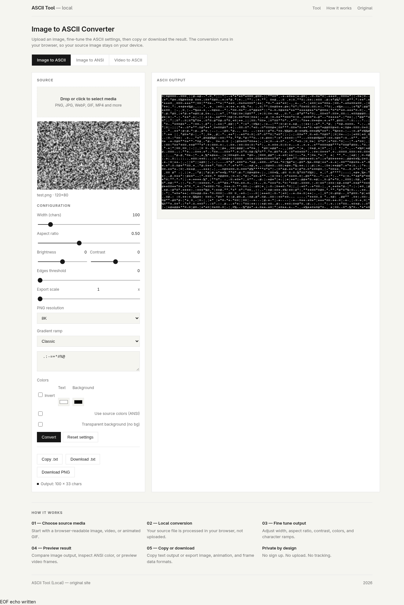
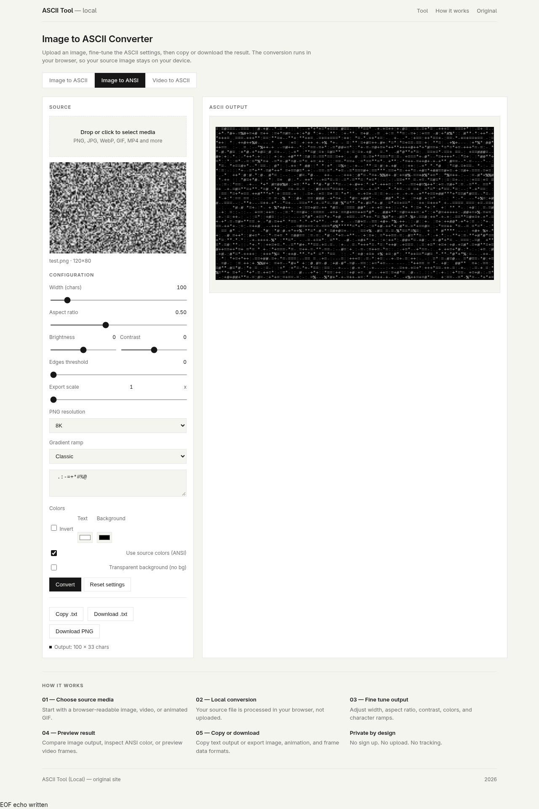
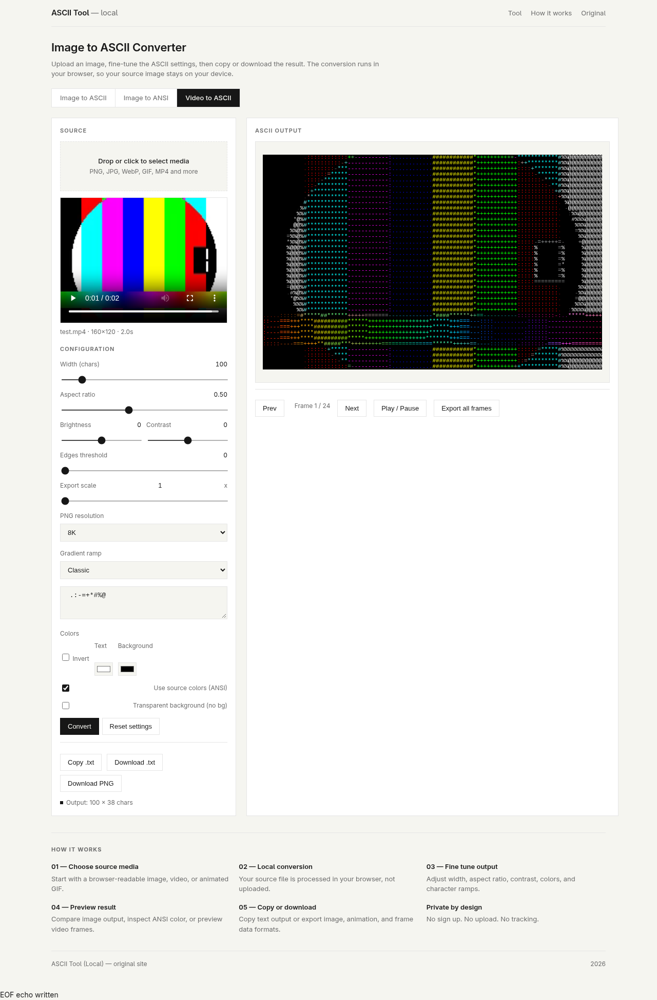

# ASCII Tool (Local)

A self-contained, browser-based tool that converts images, ANSI color, and video
into ASCII art. Everything runs locally — no uploads, no sign-up, no tracking.

Reverse-engineered from [asciitool.com](https://asciitool.com) using
[REA](https://github.com/morluto/rea) and reimplemented as a single HTML file
that works offline.

## Features

- **Image → ASCII** — convert any browser-readable image (PNG, JPG, WebP, …)
- **Image → ANSI** — colored terminal output with 24-bit color
- **Video → ASCII** — frame extraction, preview, playback, and batch export
- Adjustable width (20–768 chars), aspect ratio, brightness, contrast, edges
- Custom gradient ramps with presets (classic, blocks, dots, minimal, detailed)
- Invert, text/background colors, optional transparent background
- Export as `.txt` or PNG at Preview / 1080p / 4K / 8K resolution
- Runs entirely in the browser — media never leaves your device

## Screenshots







## Usage

Open `index.html` in any modern browser, or serve it locally:

```sh
python3 -m http.server 8000
# then open http://127.0.0.1:8000
```

Drag and drop an image or video onto the drop zone, adjust the settings, and
copy or download the result.

## Arch Linux

A PKGBUILD is included.

```sh
makepkg -si
ascii-tool
```

Or install manually:

```sh
./install.sh
```

## Files

- `index.html` — the entire application (single file, no dependencies)
- `PKGBUILD`, `ascii-tool`, `ascii-tool.desktop`, `install.sh` — Arch packaging
- `screenshots/` — captured examples

## License

MIT
EOF
echo done
